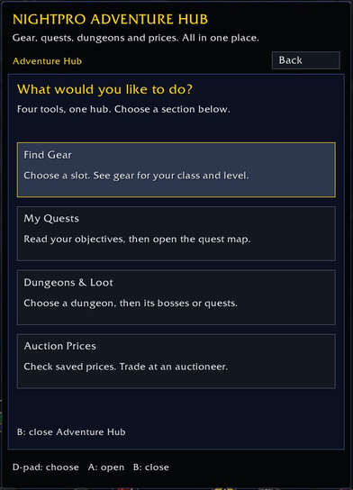

# Detailed Windows setup and recovery

I wanted to play WoW with a controller without reaching for a mouse every time I opened an addon. This is the new-player starting guide and addon setup I put together for that. I brought existing tools into one place and made them easier to navigate; the original addon authors deserve the credit for their tools.

**NightPro Adventure Hub** is a separate addon in the kit for gear, quests, dungeon loot and saved auction prices. Open it, choose what you need, then select an entry to read its details. Bags and bank keep their own controller interface.

The kit still includes Adventure Hub **and the side quest tracker**, plus bags, bank and controls. Install the required original addons through their authors' CurseForge projects. Required Dependency relationships on the kit file let a supported CurseForge client obtain those originals; a manually downloaded ZIP does not fetch them. Then close WoW and run the local connection step below. Existing settings are preserved, so an already-hidden tracker can be turned back on under **Adventure Hub > My Quests > Tracking & arrow**.

This pack is for **World of Warcraft Forever, interface 16001**. It is not a Retail or Classic pack.

[Watch the 1:45 showcase](media/NightPro-Adventure-Hub-Showcase.mp4) · [Previously published 1.5.0 alpha package](releases/Wild-Beginner-Starting-Kit-1.5.0-alpha.zip)

The showcase uses actual in-game menu captures and Windows text-to-speech narration. The original project names and credits appear throughout it.



## What you get

- **Bags and Bank — BagPad** — BagPad's native controller inventory, item actions and saved bank contents.
- **Adventure Hub** — four sections in one window: Find Gear, My Quests, Dungeons & Loot and Auction Prices. These are not four separate apps on the main menu. Gear recommendations come from GearedForever; dungeon information comes from NeedRoll; saved auction prices come from Improved Forever.
- **Quest maps and tracking** — Questie, QuestieDB and Questie Forever Gamepad. Quest details show a large target picture when the source data provides one: the item, creature, object or turn-in NPC. The picture includes a short next step and enemy levels when available. Missing enemy levels are labeled instead of guessed. LB/RB pages through additional pictures and text. Open the quest map from the same page.
- **NightPro Controls** — a large Input page. Turn controller navigation on or off, change bindings, or open Your journey inside Adventure Hub. Keyboard and mouse work in either mode.
- **Inventory — BagPad** — BagPad's saved character and inventory information.
- **Nameplates — Platynator** — an optional shortcut to Platynator. Its editor still has controls that need a pointer.

NightPro names its own launcher, shared pages and navigation adapter. Original addon windows keep their original titles, artwork and authors. We do not rename Questie Forever Gamepad, BagPad or the other addons as NightPro products.

## Install on Windows

This installation route preserves the existing NightPro menus, layout, connected gear/dungeon pages, quest pictures, source links and controller behavior. The local setup script does not download dependencies or copy their code into the kit.

1. In a supported CurseForge client, select the correct Forever installation and install the kit with its required original addons. Confirm that BagPad, GearedForever, NeedRoll, Questie, QuestieDB, Questie Forever Gamepad, Improved Forever and Improved Forever Auction appear in that same installation. Platynator remains optional. The full official links and relationship IDs are in `curseforge-dependencies.json` and `DEPENDENCIES.md`.
2. Exit WoW. Keep Battle.net open. Open PowerShell in the installed `NightProController` folder and run this command with your own path:

```powershell
.\Install.ps1 -AddonPath 'D:\World of Warcraft\_forever_\Interface\AddOns'
```

For a source checkout, run the top-level script. For a manual ZIP installation, extract both NightPro folders into AddOns and obtain each required original from its linked CurseForge project first. This script lists anything missing and stops before changing files.

**CurseForge does not execute the local connection script automatically.** The command audits the original folders, verifies all three supported source files, then appends the same small data bridges used by the existing mod. These expose GearedForever's ranking/class data, NeedRoll's dungeon data and Questie Forever Gamepad's picture helpers. No ranking, selection or model-framing algorithm is replaced. Every original byte remains at the beginning of the connected file, authors' notices and license files remain intact, and byte-for-byte backups plus a recovery record are written under `Interface\NightProKitBackups` before any bridge is installed.

Setup stages both NightPro folders and checks every destination before replacing owned files. If an owned-file copy or bridge step fails, it restores changed owned files, removes files/folders it just created when safe, and reports the backup/recovery record. Files changed externally during recovery are left for manual review. Linked destination files, folders, roots and ancestors, including Windows junctions, are refused; choose the real directory path.

Use `-Preview` to verify the plan without writing anything. Repeating setup verifies existing bridges without duplicating them. `-SkipDependencies` only bypasses the folder-presence audit for an existing installation; it does not download anything or bypass source-hash checks. `-IncludeNameplates` also checks that the optional Platynator folder is installed.

Supported bridge sources are GearedForever 1.0.1/1.0.2, NeedRoll 1.4.1/1.6.0 and Questie Forever Gamepad 0.2.93/0.3.15, each checked against its exact original file hash. Offline source/data and preview fixtures were checked; the Windows game-client check covered the connected Hub; a clean CurseForge-app installation has not yet been exercised end to end. An unrecognized update is refused before any bridge changes are made. Do not overwrite a new original with an old backup.

If Windows blocks the script, do not disable system security or change execution policy to bypass it. Review the script and use a trusted/signed workflow allowed on that computer.

3. Reopen WoW through Battle.net. Enable both NightPro addons and the originals at character selection.
4. Open wheel page 3 and select **Adventure Hub** from an empty slot, or click the split Alliance/Horde emblem on the minimap. `/adventurehub` opens the hub; `/npmenu` opens the kit settings with **Start Here** at the top.

The wheel shortcut appears only when that page has a free slot. The kit does not overwrite a filled slot or replace your bindings. **Bag Settings** opens layout/controller options; open actual inventory from **Bags** on the native wheel to retain secure item controls.

## Missing or failed dependencies

The existing menu and Adventure Hub keep their layout. Hover a tool to see its status. Start Here includes per-addon pages; use LB/RB or the mouse wheel to read them. `/npdeps` opens all dependency help in the same menu; `/npdeps NeedRoll` opens only NeedRoll. The same command accepts exact addon folder names or displayed names, including `Questie Forever Gamepad` and `Improved Forever Auction`.

Each dependency has its own verified official CurseForge URL and installation steps. These are plain addresses to open in your browser; the addon does not launch a browser, download files, enable addons, force-load them or change security/version checks.

- **NOT LOADED - missing:** the game reports the addon is absent. Close WoW, install the original Forever addon in the same game instance, then fully restart WoW. A new folder is not discovered reliably by a UI reload alone.
- **NOT LOADED - disabled:** enable that addon for this character in the AddOns list, then reload the UI.
- **Load error reported:** the game reports an error. The status says whether it still considers the addon loaded. Check the actual error and use a supported Forever release; do not disable security/version checks.
- **LOADED - connection needed:** the original is present/loaded, but the shared-data bridge is unavailable. Close WoW and rerun the local connection command after installing/updating the exact supported original.
- **LOADED - API/integration error:** the addon is loaded but a required callable interface is unavailable or a tool call failed. Repair/restart and recheck. A successful retry clears the matching reported integration failure.
- **Status unavailable:** the game did not provide enough reliable information. The kit does not guess that it is missing, disabled or unloaded.

If you intentionally leave a dependency uninstalled, available features remain usable. For a partial/manual installation, run the same setup command with the explicit option:

```powershell
.\Install.ps1 -AddonPath 'D:\World of Warcraft\_forever_\Interface\AddOns' -AllowMissingDependencies
```

This skips only wholly absent original addon folders. Installed but incomplete, linked or unknown-version sources are still refused before any connection changes. The verified available subset uses the same backup/atomicity/rollback protections. It does not download or force-enable the missing addon, and it does not change CurseForge's complete-kit relationship metadata. After installing a missing original through its author, rerun the command; existing connections are verified without duplication.

Gear/dungeon/auction sections show the specific unavailable dependency and its instructions rather than a blank failure. The native quest journal can still be read without the quest integrations. Full connected features retain the same data sources and behavior when their originals and bridges are available.

## Controller buttons

Open **NightPro Controls** from the kit menu, or use `/npcontrols`. Its Input tab has a saved **Controller navigation ON/OFF** switch. This controls the NightPro navigation adapter, Improved Forever's addon shortcuts and Questie Forever Gamepad's controller integration. It does not disable WoW's controller device or replace native bag controls. Leave it on for controller play; turn it off for keyboard and mouse play.

In this settings page, arrow keys move the selection, Left/Right changes tabs, Enter selects and Escape closes. Everything is clickable. The Journey tab opens **Adventure Hub > My Quests > Tracking & arrow** for tracker visibility, arrow size and arrow locking. **Original settings** opens Questie Forever Gamepad with its original name and artwork. The advanced editors keep their own layouts and controls.

| Button | NightPro menu and shared pages |
| --- | --- |
| D-pad | Up/down selects; left/right changes list/detail pages or map floors/zones |
| A | Open or select |
| X | Cycle a shared-window filter backward |
| B | Details → list → hub → main menu → game; dungeon folders back out one level at a time |
| LB / RB | Previous / next page in the shared window |

The hub opens on four large choices. **Find Gear** detects your class; choose a role, slot and level range, then open an item to see its source. **My Quests** shows your current journal; objectives appear after you select a quest. **Dungeons & Loot** separates bosses and loot from dungeon quests. **Auction Prices** shows saved observations, not a live remote auction house.

The Hub now displays supported dungeon and quest maps within its own window. Unsupported map layouts fall back to the original map. The menu and hub use a centered, narrow layout to fit a 9:16 center crop of 16:9 gameplay. Long descriptions have pages instead of extending off-screen. This applies to the kit's own windows; upstream settings, maps, bags and live trading windows retain their own layouts.

Bags, quest maps and live auction trading keep their own controller handling and on-screen button prompts. Text entry and some advanced editors still need a keyboard or pointer. This is not a promise that every control in every third-party addon is gamepad accessible.

The navigation adapter releases its button bindings in combat. It does not automate movement, attacks, purchases or item destruction.

Bank and inventory snapshots show what you last visited. They cannot move items remotely. Auction buying and selling still requires an auctioneer.

## Updates and removal

CurseForge manages the original addons and their updates. An update normally replaces a locally connected source file with the author's new original. While WoW is closed, rerun the local setup command after an update. Known sources are reconnected; unknown sources stop safely for compatibility review. Source-hash acceptance is not a promise that future releases will preserve every API.

To remove only the local bridges while keeping the original addons and their exact supported source bytes, close WoW and run:

```powershell
.\Install-Bridges.ps1 -AddonPath 'D:\World of Warcraft\_forever_\Interface\AddOns' -Restore
```

Add `-Preview` to inspect restoration first. For a partial installation, also add `-AllowMissingDependencies`; only recognized present originals are restored. Restoration verifies the exact current base and removes only this script's recognized suffix. It will not copy an older source over an updated original. If a write fails during connection/restoration, already-written files are rolled back when they still match the script's expected bytes; the recovery record reports any file needing manual review.

Disable **NightPro | Wild Beginner Starting Kit** and **NightPro Adventure Hub** to remove the launcher/shared pages. Original addons retain their own windows and controls. The `WTF` folder and saved preferences are never copied or changed. Backups of changed NightPro-owned files and all bridge backups remain under `Interface\NightProKitBackups` for recovery.

## Credit where it's due

Most of the heavy lifting already existed. Chris built BagPad's controller bags. markg built Improved Forever and its auction controls. Tombons97 and the Questie Forever Gamepad contributors made the quest interface work with a controller. GearedForever and NeedRoll provide the gear and dungeon information.

I brought these tools together, added the shared NightPro pages, navigation for supported windows, and packaged the setup for other new players. I did not create the original addons or their databases.

See [CREDITS.md](CREDITS.md) for the authors, source links and licenses. The same core credits are available from the in-game menu.

## Development

The NightPro adapter is GPL-3.0-only. Dependencies are installed from their original CurseForge projects under their own licenses; their code is not mirrored in this repository.

Run `python -m pip install -r tests/requirements.txt`, then the controller, workbench, portrait, settings, dependency-state and dependency-UI Python tests in `tests/`. With separately downloaded original archives, run `python tests/test_distribution_setup.py --pwsh /path/to/pwsh --archives /path/to/archives` and `python tests/test_upstream_bridge_contracts.py --archives /path/to/archives`. These are offline fixture tests. The PowerShell wrapper `tests/Test-Installer.ps1` accepts `-ArchiveDirectory`. These tests cover menu navigation, missing dependencies, combat guards and preservation of existing addon files. They do not replace an in-game check after a client update.

## Stability notes

The shared pages draw six list rows at a time. Details open on their own page. They do not repeatedly scan the upstream window tree or open item tooltips while you move focus. Gear ranks only when you open it or change a filter. A page error is caught so B can still return to the hub. The last twelve page errors or blocked controller actions are saved locally in `NightProKitDiagnostics`.

A full game exit was reported during testing of the previous interface. No crash report was available to establish its cause. These changes reduce UI work and avoid the old automatic tooltip path; they do not establish that a native client crash is fixed. Advanced settings, map pages and the live auction transaction window still belong to the upstream addons.