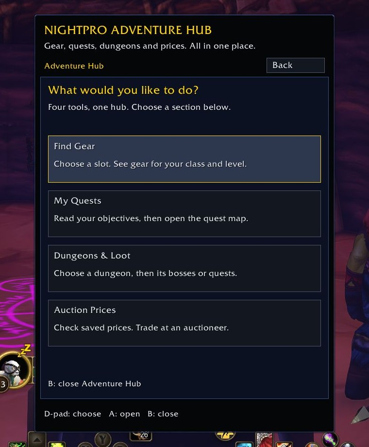
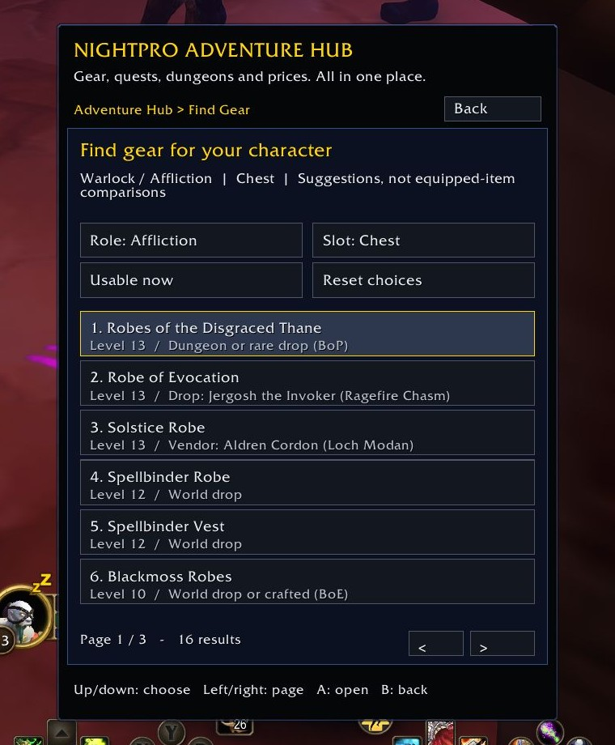
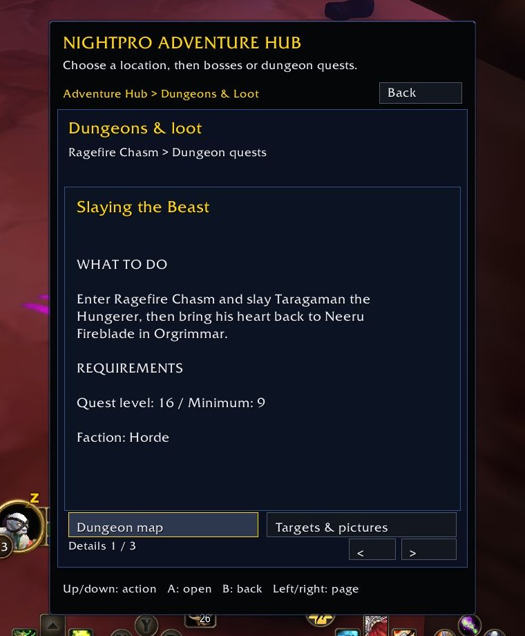
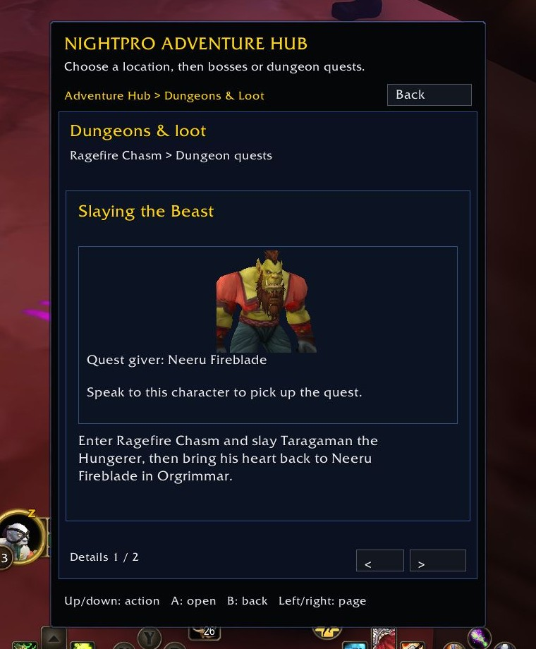
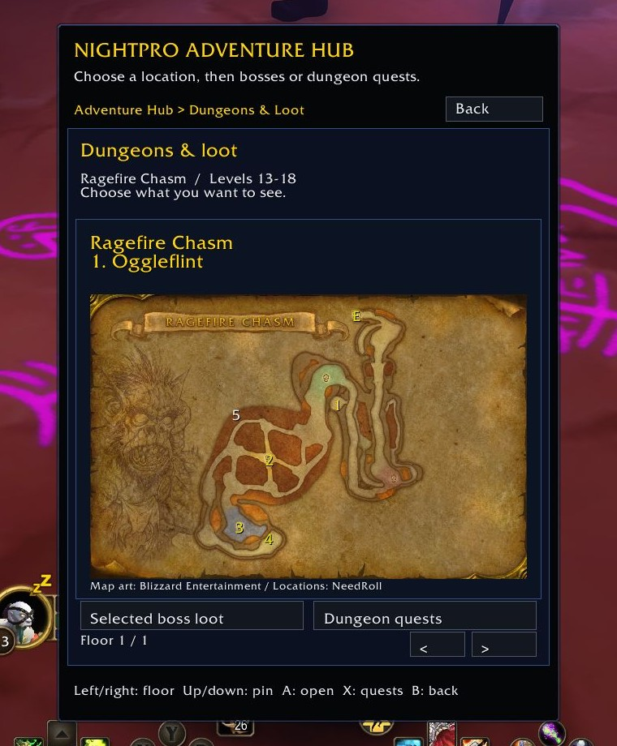
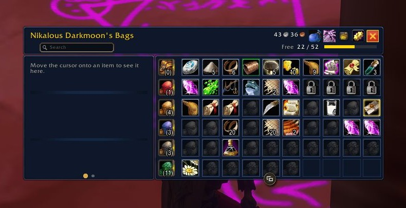

# Wild Starting Kit - The Last Addon Hub You Need

A **WoW Forever addon hub for new players**, with optional controller support. Find gear for your class, read your quests, explore dungeon loot and check saved auction prices without juggling four different menus.

I put this together because I wanted to spend more time playing and less time figuring out addon windows. **NightPro Adventure Hub brings the tools together. The original authors built the addons and databases that make it possible.**

This is the same Wild Beginner Starting Kit project, with a shorter name. Your existing installation and saved settings carry over.

**For World of Warcraft Forever, interface 16001. Windows setup. Not Retail or Classic.**

## Current update

**1.5.2 Beta** adds D-pad page changes, connected gear/quest/dungeon paths, in-Hub maps and better quest-picture framing. The page controls and return navigation were tested in WoW on Windows and confirmed with a physical controller. This is a Beta; broader dungeon and addon-version coverage is still being checked.

[Download the 1.5.2 Beta ZIP](releases/Wild-Beginner-Starting-Kit-1.5.2-beta.zip) · [CurseForge listing](https://www.curseforge.com/wow/addons/wild-beginner-starting-kit) · [Changes](CHANGELOG.md)

## What's inside

- **Find Gear:** choose your role, equipment slot and level range. Follow supported item sources into the dungeon loot or quest guide.
- **My Quests:** read the next step, objectives and known level requirements. See target pictures and quest locations where the original data provides them.
- **Dungeons & Loot:** browse bosses, rewards and dungeon quests. Open a layout map inside the Hub, switch floors and select a boss to see its loot.
- **Quest tracking and navigation:** use the side tracker and arrow supplied by Questie Forever Gamepad, with their controls gathered under **My Quests > Tracking & arrow**.
- **Bags and bank:** keep BagPad's controller inventory, item actions and saved bank view.
- **Auction Prices:** check saved prices. Buying and selling still happen at an auctioneer.

The Hub has one shared layout, a visible Back button and readable pages. Its centered menus fit a portrait crop. Keyboard and mouse work too; controller navigation can be switched off.

## Install in four steps

**1. Install the kit and the original addons.**

In the CurseForge app, choose your **Forever** game installation, then install this kit. Use its current Beta file if your app is set to Releases only. The Beta's required dependencies point to the authors' own projects. Check that all eight required addons are installed in the same game folder. Platynator is optional.

Downloaded the ZIP manually? Extract **NightProController** and **NightProAdventureHub** into `_forever_\Interface\AddOns`, then install the eight originals from the links below. A ZIP cannot download them for you.

**2. Close WoW and connect the addons once.**

Open `_forever_\Interface\AddOns\NightProController` in File Explorer. Open PowerShell in that folder, then paste:

```powershell
.\Install.ps1 -AddonPath (Split-Path -Parent $PWD.Path)
```

This connects the supported original versions to the Hub and saves backups first. It downloads nothing. CurseForge does **not** run this step automatically. If setup reports an unsupported version or Windows blocks the script, stop and use the setup help below.

**3. Launch WoW through Battle.net.**

At character selection, enable both NightPro addons and the required originals in **AddOns**.

**4. Open Adventure Hub.**

Click the split Alliance/Horde emblem by the minimap, or use the **Adventure Hub** shortcut on controller wheel page 3 if a slot is free. You can also type `/adventurehub`.

Start with **Find Gear**, **My Quests**, **Dungeons & Loot** or **Auction Prices**. `/npmenu` opens the kit's **Start Here**, bag settings, controls and credits.

## Controls and quick fixes

- **D-pad up/down:** choose an entry or action.
- **D-pad left/right:** change list/detail pages; change floors or zones on a map.
- **A:** open. **B:** go back to where you came from.
- **LB/RB:** previous/next page. Filters and map actions show their own prompts.
- **Keyboard and mouse:** click the same buttons. Turn controller navigation off under **NightPro Controls > Input** if you prefer.

Missing a tool? Type `/npdeps` for its status and original download link. Tracker hidden? Open **My Quests > Tracking & arrow**. Updated an original addon? Close WoW and run the connection step again; unknown versions stop for review rather than being overwritten.

Bank and auction views show saved information. Some advanced original settings and text fields still need a mouse or keyboard. The kit does not automate movement, combat or trading.

## In-game screenshots

Screenshots from the 1.5.2 Beta, with the pointer moved away from the menus. Cropped for readability; game UI content is unchanged.



| Gear for your class | Quest instructions and levels |
| --- | --- |
|  |  |

| NPC pictures | Dungeon maps and loot |
| --- | --- |
|  |  |



## Built on the work of these authors

Install these **eight required originals** through their own projects:

- [BagPad](https://www.curseforge.com/wow/addons/bagpad-forever) — **Chris / TheFerdinandGamer**: controller bags, bank and inventory.
- [GearedForever](https://www.curseforge.com/wow/addons/gearedforever) — **Nathan / fistedwaffles05**: gear information and rankings.
- [NeedRoll](https://www.curseforge.com/wow/addons/needroll) — **mikebvs / flowmotion_x**: dungeon maps, loot and quest information.
- [Questie](https://www.curseforge.com/wow/addons/questie) — **the Questie contributors**: quest information, maps and tracking.
- [QuestieDB](https://www.curseforge.com/wow/addons/questiedb) — **Logonz and the Questie contributors**: quest database.
- [Questie Forever Gamepad](https://www.curseforge.com/wow/addons/questie-forever-gamepad) — **Tombons97 and contributors**: controller quest support, tracker, arrow and picture helpers.
- [Improved Forever](https://www.curseforge.com/wow/addons/improved-forever) — **markg / markgravity**: controller settings and bindings.
- [Improved Forever Auction](https://www.curseforge.com/wow/addons/improved-forever-auction) — **markg / markgravity**: auction controls and price information.

[Platynator](https://www.curseforge.com/wow/addons/platynator) by **plusmouse** is optional. Thanks also to **moust4ki**, whose [Easy Controller](https://github.com/moust4ki/EasyControllerWowForever) work is credited by Improved Forever, and **xeR**, whose Forever Quality of Life Settings is the visual reference credited by BagPad. Individual map-art credits are preserved where supplied.

**I built the shared Hub, navigation adapter and setup around their work. I did not create or rename their addons.** The kit does not bundle their source or databases. Required dependencies keep downloads on the original authors' projects. Each project keeps its own name, license and credit. World of Warcraft and its game assets belong to Blizzard Entertainment.

[Detailed Windows setup and recovery](https://github.com/FRANKTHETANK-exe/Wild-Beginner-Starting-Kit/blob/main/INSTALL.md) · [Full author and license credits](https://github.com/FRANKTHETANK-exe/Wild-Beginner-Starting-Kit/blob/main/CREDITS.md) · [Supported versions](https://github.com/FRANKTHETANK-exe/Wild-Beginner-Starting-Kit/blob/main/DEPENDENCIES.md) · [Report a problem](https://github.com/FRANKTHETANK-exe/Wild-Beginner-Starting-Kit/issues)
