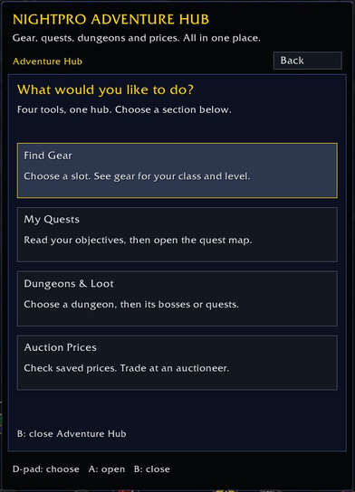

# Wild Beginner Starting Kit with Controller Support

I wanted to play WoW with a controller without reaching for a mouse every time I opened an addon. This is the new-player starting guide and addon setup I put together for that. I brought existing tools into one place and made them easier to navigate; the original addon authors deserve the credit for their tools.

**NightPro Adventure Hub** is a separate addon in the kit for gear, quests, dungeon loot and saved auction prices. Open it, choose what you need, then select an entry to read its details. Bags and bank keep their own controller interface.

One normal install includes Adventure Hub **and the side quest tracker**, plus bags, bank, controls and their required addons. You do not need to install Questie separately: the installer gets Questie, QuestieDB and Questie Forever Gamepad for you. The first install needs an internet connection. Existing settings are preserved, so an already-hidden tracker can be turned back on under **Adventure Hub > My Quests > Tracking & arrow**. `-SkipDependencies` is for updating an existing installation, not setting up the complete kit on a new computer.

This pack is for **World of Warcraft Forever, interface 16001**. It is not a Retail or Classic pack.

[Watch the 1:45 showcase](media/NightPro-Adventure-Hub-Showcase.mp4) · [Download the 1.5.0 alpha package](releases/Wild-Beginner-Starting-Kit-1.5.0-alpha.zip)

The showcase uses actual in-game menu captures and Windows text-to-speech narration. The original project names and credits appear throughout it.



## What you get

- **Bags and Bank — BagPad** — BagPad's native controller inventory, item actions and saved bank contents.
- **Adventure Hub** — four sections in one window: Find Gear, My Quests, Dungeons & Loot and Auction Prices. These are not four separate apps on the main menu. Gear recommendations come from GearedForever; dungeon information comes from NeedRoll; saved auction prices come from Improved Forever.
- **Quest maps and tracking** — Questie, QuestieDB and Questie Forever Gamepad. Quest details show a large target picture when the source data provides one: the item, creature, object or turn-in NPC. The picture includes a short next step and enemy levels when available. Missing enemy levels are labeled instead of guessed. LB/RB pages through additional pictures and text. Open the quest map from the same page.
- **NightPro Controls** — a large Input page. Turn controller navigation on or off, change bindings, or open Your journey inside Adventure Hub. Keyboard and mouse work in either mode.
- **Inventory — BagPad** — BagPad's saved character and inventory information.
- **Nameplates — Platynator** — an optional shortcut to Platynator. Its editor still has controls that need a pointer.

NightPro names its own launcher, shared pages and navigation adapter. Original addon windows keep their original titles, artwork and authors. We do not rename Questie Forever Gamepad, BagPad or the other addons as NightPro products.

## Install on Windows

The installable release ZIP contains the two addon folders. Extract them into your AddOns folder, close WoW, and run the included `NightProController/Install.ps1` with your AddOns path to finish dependency and bridge setup. CurseForge does not run PowerShell setup scripts automatically. The steps below also work from a source ZIP; in that case the script is at the top level.

1. Download the release ZIP and extract it.
2. Exit WoW. Keep Battle.net open.
3. Open PowerShell inside the extracted `NightProController` folder (or the top-level folder for a source checkout). Run this command using your own WoW path:

```powershell
.\Install.ps1 -AddonPath 'D:\World of Warcraft\_forever_\Interface\AddOns'
```

The installer downloads pinned releases from the original distribution hosts and checks their SHA-256 hashes. Existing addon packages are not replaced. For the supported GearedForever, NeedRoll and Questie Forever Gamepad files, the installer verifies their exact hashes and appends small bridges for data and quest pictures. It backs up the original files first and refuses unknown versions. An existing NightPro menu gets backed up under `Interface\NightProKitBackups` before it is updated. Your `WTF` folder and saved settings are never copied or changed.

Use `-Preview` to see the plan without installing anything. Use `-SkipDependencies` to install the NightPro menu and Adventure Hub, or `-IncludeNameplates` to add Platynator. Copying only the companion folder does not install the data bridges required by Gear, Dungeons and quest pictures. The installer handles them; `Install-Bridges.ps1` can verify or reapply them separately after an upstream update, provided the file hashes are supported.

4. Launch WoW through Battle.net. Enable the addons at character selection.
5. Open wheel page 3 and select **Adventure Hub** from an empty slot, or click the split Alliance/Horde emblem on the minimap. `/adventurehub` opens the hub; `/npmenu` opens the kit settings with **Start Here** at the top.

The wheel shortcut appears only when that page has a free slot. The kit does not overwrite a filled slot or replace your bindings.

**Bag Settings** opens the layout and controller options. Open your actual inventory from **Bags** on the native wheel; that preserves the game's secure item controls. **Inventory** opens the visual snapshot browser.

## Controller buttons

Open **NightPro Controls** from the kit menu, or use `/npcontrols`. Its Input tab has a saved **Controller navigation ON/OFF** switch. This controls the NightPro navigation adapter, Improved Forever's addon shortcuts and Questie Forever Gamepad's controller integration. It does not disable WoW's controller device or replace native bag controls. Leave it on for controller play; turn it off for keyboard and mouse play.

In this settings page, arrow keys move the selection, Left/Right changes tabs, Enter selects and Escape closes. Everything is clickable. The Journey tab opens **Adventure Hub > My Quests > Tracking & arrow** for tracker visibility, arrow size and arrow locking. **Original settings** opens Questie Forever Gamepad with its original name and artwork. The advanced editors keep their own layouts and controls.

| Button | NightPro menu and shared pages |
| --- | --- |
| D-pad | Choose a section, filter, entry or action |
| A | Open or select |
| X | Cycle a shared-window filter backward |
| B | Details → list → hub → main menu → game; dungeon folders back out one level at a time |
| LB / RB | Previous / next page in the shared window |

The hub opens on four large choices. **Find Gear** detects your class; choose a role, slot and level range, then open an item to see its source. **My Quests** shows your current journal; objectives appear after you select a quest. **Dungeons & Loot** separates bosses and loot from dungeon quests. **Auction Prices** shows saved observations, not a live remote auction house.

The menu and hub use a centered, narrow layout to fit a 9:16 center crop of 16:9 gameplay. Long descriptions have pages instead of extending off-screen. This applies to the kit's own windows; upstream settings, maps, bags and live trading windows retain their own layouts.

Bags, quest maps and live auction trading keep their own controller handling and on-screen button prompts. Text entry and some advanced editors still need a keyboard or pointer. This is not a promise that every control in every third-party addon is gamepad accessible.

The navigation adapter releases its button bindings in combat. It does not automate movement, attacks, purchases or item destruction.

Bank and inventory snapshots show what you last visited. They cannot move items remotely. Auction buying and selling still requires an auctioneer.

## Updates and removal

The versions in `dependencies.json` are pinned. An existing addon package is skipped, even if its version differs. The data bridges are applied only to verified supported source files; an unknown source file stops bridge installation. Update those addons through their original pages when you choose to; a newer version may change the interface this pack expects.

To remove the shared menu and theme, disable **NightPro | Wild Beginner Starting Kit** and **NightPro Adventure Hub** in the AddOns list. The original addons keep working. The appended data bridges only expose data references and are inactive without the companion. Original files are backed up under `Interface\NightProKitBackups\bridges-*`. A previous menu can be restored from `Interface\NightProKitBackups` while WoW is closed.

## Credit where it's due

Most of the heavy lifting already existed. Chris built BagPad's controller bags. markg built Improved Forever and its auction controls. Tombons97 and the Questie Forever Gamepad contributors made the quest interface work with a controller. GearedForever and NeedRoll provide the gear and dungeon information.

I brought these tools together, added the shared NightPro pages, navigation for supported windows, and packaged the setup for other new players. I did not create the original addons or their databases.

See [CREDITS.md](CREDITS.md) for the authors, source links and licenses. The same core credits are available from the in-game menu.

## Development

The NightPro adapter is GPL-3.0-only. Dependencies are downloaded separately under their own licenses; their code is not mirrored in this repository.

Run `python -m pip install -r tests/requirements.txt`, then `python tests/test_controller.py` and `python tests/test_workbench.py`. On Windows, run `powershell -File tests/Test-Installer.ps1` for the installer checks. These tests cover menu navigation, missing dependencies, combat guards and preservation of existing addon files. They do not replace an in-game check after a client update.

## Stability notes

The shared pages draw six list rows at a time. Details open on their own page. They do not repeatedly scan the upstream window tree or open item tooltips while you move focus. Gear ranks only when you open it or change a filter. A page error is caught so B can still return to the hub. The last twelve page errors or blocked controller actions are saved locally in `NightProKitDiagnostics`.

A full game exit was reported during testing of the previous interface. No crash report was available to establish its cause. These changes reduce UI work and avoid the old automatic tooltip path; they do not establish that a native client crash is fixed. Advanced settings, map pages and the live auction transaction window still belong to the upstream addons.